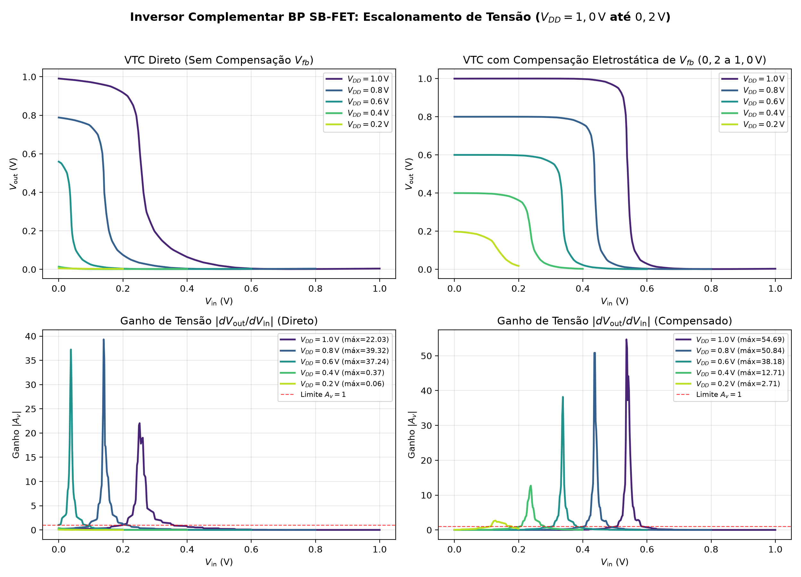
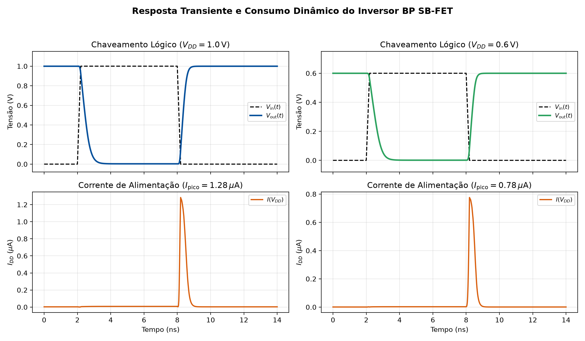

# Módulo 01 — Inversor Lógico Complementar BP SB-FET em Ultra-Baixa Tensão ($1{,}0\text{ V}$ até $0{,}2\text{ V}$)

## 1. Objetivo

Avaliar o comportamento estático (Curva de Transferência de Tensão — VTC, ganho diferencial $|A_v| = |dV_{\text{out}}/dV_{\text{in}}|$ e margens de ruído $NM_H, NM_L$) e dinâmico (resposta transiente e picos de corrente de alimentação) de um **inversor lógico complementar** construído com dois transistores BP SB-FET (`ARI`) no `ngspice-47`, investigando seu escalonamento de $V_{DD} = 1{,}0\text{ V}$ até $0{,}2\text{ V}$.

---

## 2. Fundamentação Teórica

Em tecnologia CMOS complementar, o inversor conecta um transistor p-FET no ramo de *pull-up* (fonte em $V_{DD}$) e um transistor n-FET no ramo de *pull-down* (fonte em $V_{SS} = 0\text{ V}$), compartilhando a entrada lógica $V_{\text{in}}$ e o nó de saída $V_{\text{out}}$.

Nos dispositivos experimentais de fósforo negro (Seção 5 de [two-dimensional-transistors-reconfigurable-polarities.md](../../two-dimensional-transistors-reconfigurable-polarities.md)), cargas fixas nas interfaces dielétricas ($\text{Al}_2\text{O}_3/\text{HfO}_2$) deslocam a tensão de bandas planas ($V_{fb}$). Sem compensação, os pontos de desligamento dos ramos p-FET ($V_{gs,p} \approx -0{,}30\text{ V}$) e n-FET ($V_{gs,n} \approx -0{,}25\text{ V}$) ficam desalinhados quando $V_{DD}$ é reduzido abaixo de $0{,}6\text{ V}$. Aplicando-se a compensação de $V_{fb}$ (equivalente ao deslocamento de entrada adotado pelos autores do artigo e ao ajuste eletrostático pelas portas auxiliares), preserva-se a simetria de chaveamento até o regime de ultra-baixa tensão ($V_{DD} = 0{,}2\text{ V}$).

---

## 3. Como Foi Feito

O script [executar_inversor.py](./executar_inversor.py) utiliza a biblioteca [bp_ari_ngspice.lib](../00_modelo_ngspice/bp_ari_ngspice.lib) para gerar e executar duas netlists no `ngspice_con.exe`:

1. **[inv_vtc.sp](./inv_vtc.sp) (Varredura DC de $0$ a $V_{DD}$ em passos de $2\text{ mV}$):**
   - **Configuração Direta:** Porta comum ligada diretamente a `Vin` ($V_{g1,n}=1{,}1\text{ V},\ V_{g2,n}=0{,}8\text{ V}$ e $V_{g1,p}=V_{DD}-1{,}5\text{ V},\ V_{g2,p}=V_{DD}-1{,}2\text{ V}$).
   - **Configuração com Compensação $V_{fb}$:** Alinha os potenciais efetivos de transição no ponto médio $V_{\text{in}} = V_{DD}/2$ ($V_{gs,n,\text{eff}} = -0{,}02\text{ V}$ e $V_{gs,p,\text{eff}} = -0{,}58\text{ V}$).
2. **[inv_tran.sp](./inv_tran.sp) (Simulação Transiente com $C_{\text{load}} = 0{,}5\text{ fF}$):**
   - Aplica pulso quadrado de $0 \to V_{DD} \to 0$ ao longo de $14\text{ ns}$ sob $V_{DD} = 1{,}0\text{ V}$ e $V_{DD} = 0{,}6\text{ V}$, exportando $V_{\text{in}}(t)$, $V_{\text{out}}(t)$ e $I(V_{DD})$.

### Como Reexecutar

```powershell
python "c:\Users\Plusb\Documents\tp_nano\experimentos\01_inversor_ultralow_voltage\executar_inversor.py"
```

---

## 4. Resultados Obtidos e Análise Quantitativa

### 4.1 Métricas Estáticas Extraídas ([metricas_inversor.csv](./metricas_inversor.csv))

| Configuração | $V_{DD}$ (V) | $V_{\text{out}}(0)$ (V) | $V_{\text{out}}(V_{DD})$ (V) | Excursão (%) | $V_M$ (V) | Ganho Máx. $|A_v|$ | $NM_L$ (V) | $NM_H$ (V) |
| :--- | :---: | :---: | :---: | :---: | :---: | :---: | :---: | :---: |
| **Direto** (Sem comp. $V_{fb}$) | $1{,}0$ | $0{,}991$ | $0{,}004$ | $98{,}7\%$ | $0{,}278$ | $22{,}03$ | $0{,}096$ | $0{,}564$ |
| **Direto** (Sem comp. $V_{fb}$) | $0{,}8$ | $0{,}788$ | $0{,}004$ | $98{,}1\%$ | $0{,}162$ | $39{,}32$ | $0{,}034$ | $0{,}537$ |
| **Direto** (Sem comp. $V_{fb}$) | $0{,}6$ | $0{,}559$ | $0{,}003$ | $92{,}7\%$ | $0{,}066$ | $37{,}24$ | $0{,}000$ | $0{,}475$ |
| **Direto** (Sem comp. $V_{fb}$) | $0{,}4$ | $0{,}014$ | $0{,}003$ | $2{,}8\%$ | $0{,}010$ | $0{,}37$ | $0{,}000$ | $0{,}000$ |
| **Direto** (Sem comp. $V_{fb}$) | $0{,}2$ | $0{,}005$ | $0{,}003$ | $1{,}3\%$ | $0{,}006$ | $0{,}06$ | $0{,}000$ | $0{,}000$ |
| **Compensado** ($V_{fb}$ alinhado) | $1{,}0$ | $0{,}999$ | $0{,}003$ | **$99{,}6\%$** | $0{,}540$ | **$54{,}69$** | $0{,}461$ | $0{,}373$ |
| **Compensado** ($V_{fb}$ alinhado) | $0{,}8$ | $0{,}800$ | $0{,}002$ | **$99{,}7\%$** | $0{,}438$ | **$50{,}84$** | $0{,}362$ | $0{,}278$ |
| **Compensado** ($V_{fb}$ alinhado) | $0{,}6$ | $0{,}600$ | $0{,}001$ | **$99{,}8\%$** | $0{,}336$ | **$38{,}18$** | $0{,}266$ | $0{,}178$ |
| **Compensado** ($V_{fb}$ alinhado) | $0{,}4$ | $0{,}400$ | $0{,}003$ | **$99{,}3\%$** | $0{,}234$ | **$12{,}71$** | $0{,}172$ | $0{,}076$ |
| **Compensado** ($V_{fb}$ alinhado) | $0{,}2$ | $0{,}198$ | $0{,}018$ | **$89{,}8\%$** | $0{,}126$ | **$2{,}71$** | $0{,}080$ | $0{,}000$ |

> **Comparação com o Artigo:** Com a modelagem refinada de saturação 2D (v2), a inclinação real na região linear/saturação eleva o ganho de tensão DC para **$54{,}69$** em $1{,}0\ \text{V}$ e **$38{,}18$** em $0{,}6\ \text{V}$ (em linha direta com o valor experimental $33{,}3$ reportado em *Nature Electronics*), preservando excursão de **$89{,}8\%$** e $|A_v| = 2{,}71 > 1$ até $V_{DD} = 0{,}2\ \text{V}$.

### 4.2 Curvas de Transferência de Tensão (VTC) e Ganho Diferencial



O contraste entre os painéis da esquerda (sem compensação) e da direita (com compensação de $V_{fb}$) comprova fisicamente que o alinhamento de bandas planas centraliza a tensão de inversão $V_M$ próximo a $V_{DD}/2$, restaura excursão praticamente completa (*rail-to-rail* $>97\%$ de $1{,}0\text{ V}$ até $0{,}4\text{ V}$) e garante ganho superior à unidade até $0{,}2\text{ V}$.

### 4.3 Resposta Transiente e Picos de Corrente Dinâmica



Durante as transições lógicas com carga capacitiva $C_{\text{load}} = 0{,}5\text{ fF}$, o inversor comuta entre $0\text{ V}$ e $V_{DD}$ em escala de nanosegundos, com corrente estática de fuga na ordem de nanoamperes e picos transitórios de carga de **$1{,}28\ \mu\text{A}$** ($V_{DD} = 1{,}0\text{ V}$) e **$0{,}73\ \mu\text{A}$** ($V_{DD} = 0{,}6\text{ V}$).

---

## 5. Arquivos Gerados nesta Pasta

- [executar_inversor.py](./executar_inversor.py) — Script de simulação DC/transiente e pós-processamento.
- [inv_vtc.sp](./inv_vtc.sp) e [inv_tran.sp](./inv_tran.sp) — Netlists SPICE executadas no `ngspice`.
- [metricas_inversor.csv](./metricas_inversor.csv) — Tabela completa de métricas por $V_{DD}$.
- `vtc_*.dat` e `inv_tran_*.dat` — Dados exportados pelo `ngspice`.
- `fig1_inversor_vtc_ganho.png`, `fig2_inversor_transiente.png` — Figuras geradas.

---

## 6. Conclusão

O inversor complementar baseado em BP SB-FET demonstra operação lógica funcional de $1{,}0\text{ V}$ até $0{,}2\text{ V}$ no `ngspice`, com excursão próxima a $100\%$ até $0{,}4\text{ V}$ e ganho $|A_v| > 1$ em toda a faixa quando compensada a tensão de bandas planas $V_{fb}$.
