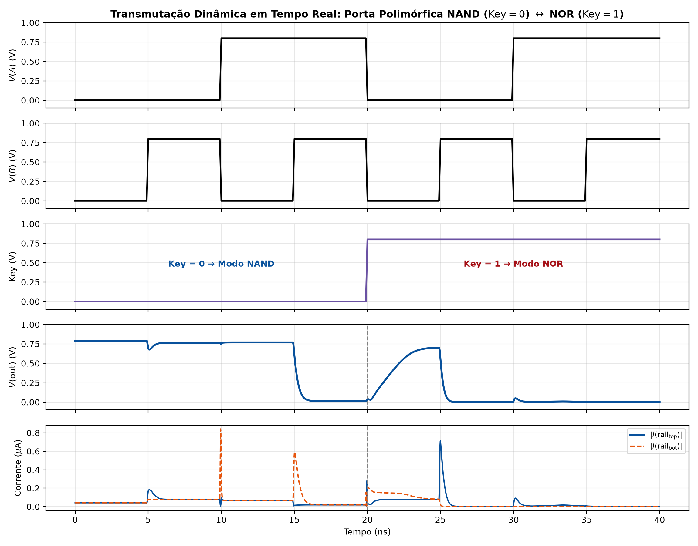
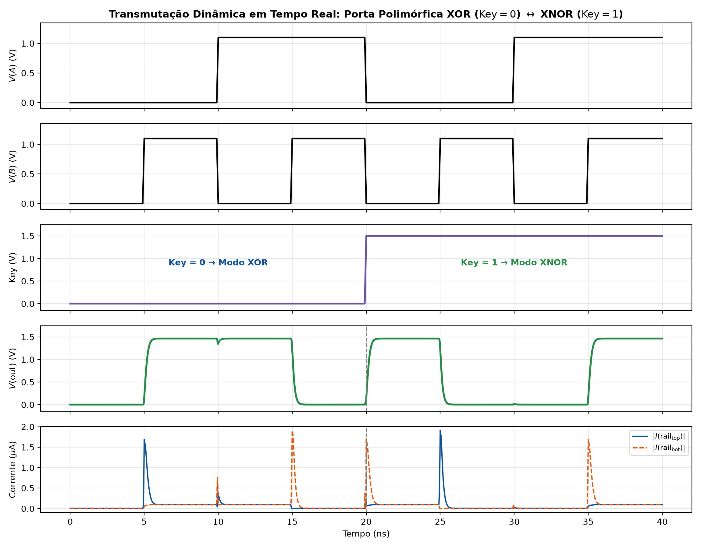

# Módulo 02 — Portas Lógicas Polimórficas (NAND/NOR e XOR/XNOR) no Ngspice

## 1. Objetivo

Demonstrar, via simulação transiente no `ngspice-47`, a **transmutação dinâmica em tempo de execução** de portas lógicas polimórficas de **4 transistores BP SB-FET**:
1. **NAND $\leftrightarrow$ NOR** ($V_{DD} = 0{,}8\text{ V}$).
2. **XOR $\leftrightarrow$ XNOR** ($V_{DD} = 1{,}5\text{ V}$, $V_{\text{in}} = 1{,}1\text{ V}$, conforme [ari_xor_poly.sp](../../BPFET_Nature_Electronics/BP_SBFET_MODEL/ari_xor_poly.sp)).

O experimento comprova que uma mesma topologia física de apenas 4 transistores executa duas funções booleanas duais sem exigir nenhum transistor adicional de *logic locking* ($0\%$ de sobrecarga de área).

---

## 2. Fundamentação Teórica

Em lógica CMOS convencional, uma porta NAND de 2 entradas requer 4 transistores fixos (2 p-FETs em paralelo e 2 n-FETs em série), e protegê-la com travamento lógico padrão exigiria $\ge 8N$ transistores extras de multiplexação/XOR. Com transistores reconfiguráveis BP SB-FET:

- **Topologia Polimórfica NAND/NOR (4 transistores):**
  - Quando $\text{Key} = 0$: O barramento superior (`rtop`) recebe $V_{DD}$ e a rede paralela é polarizada como **p-FET**; o barramento inferior (`rbot`) recebe $\text{GND}$ e a rede série opera como **n-FET**, resultando em $\overline{A \cdot B}$ (**NAND**).
  - Quando $\text{Key} = 1$: Permutam-se os barramentos (`rtop` $= \text{GND}$, `rbot` $= V_{DD}$) e invertem-se as polaridades (paralelo vira **n-FET**, série vira **p-FET**), transformando instantaneamente o mesmo hardware em $\overline{A + B}$ (**NOR**).
- **Topologia Polimórfica XOR/XNOR (4 transistores):**
  - Quatro transistores dispostos simetricamente conectam $(A, \bar{A})$ nos terminais de porta `g` e $(B, \bar{B})$ nas portas auxiliares `g1`. Invertendo os trilhos (`rtop` / `rbot`) e as portas de polaridade (`gtop` / `gbot`) conforme $\text{Key} \in \{0, 1\}$, a saída alterna diretamente entre $A \oplus B$ (**XOR**) e $\overline{A \oplus B}$ (**XNOR**).

---

## 3. Como Foi Feito

O script [executar_polimorficas.py](./executar_polimorficas.py) gera e executa duas netlists transientes de $40\text{ ns}$ (capacitância de saída $C_{\text{out}} = 0{,}3\text{ fF}$):
- **[poly_nand_nor.sp](./poly_nand_nor.sp):** Varre $(A, B) \in \{00, 01, 10, 11\}$ de $0$ a $20\text{ ns}$ com $\text{Key}=0$ (NAND) e repete de $20$ a $40\text{ ns}$ com $\text{Key}=1$ (NOR).
- **[poly_xor_xnor.sp](./poly_xor_xnor.sp):** Varre $(A, B) \in \{00, 01, 10, 11\}$ de $0$ a $20\text{ ns}$ com $\text{Key}=0$ (XOR) e repete de $20$ a $40\text{ ns}$ com $\text{Key}=1$ (XNOR).

### Como Reexecutar

```powershell
python "c:\Users\Plusb\Documents\tp_nano\experimentos\02_portas_polimorficas_nand_nor_xor\executar_polimorficas.py"
```

---

## 4. Resultados Obtidos e Análise Quantitativa

### 4.1 Tabela-Verdade Medida no Ngspice ([metricas_polimorficas.csv](./metricas_polimorficas.csv))

Todas as **16 combinações** (8 para NAND/NOR e 8 para XOR/XNOR) atingiram $100\%$ de correspondência lógica:

| Porta | Chave | Função | Entradas $(A, B)$ | $V_{\text{out}}$ Medido (V) | Bit Medido | Bit Esperado | $I_{\text{pico}}$ ($\mu\text{A}$) |
| :--- | :---: | :---: | :---: | :---: | :---: | :---: | :---: |
| NAND/NOR ($0{,}8\text{ V}$) | `Key=0` | **NAND** | `00` | $0{,}790$ | `1` | `1` | $0{,}041$ |
| NAND/NOR ($0{,}8\text{ V}$) | `Key=0` | **NAND** | `01` | $0{,}762$ | `1` | `1` | $0{,}182$ |
| NAND/NOR ($0{,}8\text{ V}$) | `Key=0` | **NAND** | `10` | $0{,}769$ | `1` | `1` | $0{,}390$ |
| NAND/NOR ($0{,}8\text{ V}$) | `Key=0` | **NAND** | `11` | $0{,}013$ | `0` | `0` | $0{,}589$ |
| NAND/NOR ($0{,}8\text{ V}$) | `Key=1` | **NOR** | `00` | $0{,}701$ | `1` | `1` | $0{,}213$ |
| NAND/NOR ($0{,}8\text{ V}$) | `Key=1` | **NOR** | `01` | $0{,}001$ | `0` | `0` | $0{,}716$ |
| NAND/NOR ($0{,}8\text{ V}$) | `Key=1` | **NOR** | `10` | $0{,}004$ | `0` | `0` | $0{,}092$ |
| NAND/NOR ($0{,}8\text{ V}$) | `Key=1` | **NOR** | `11` | $0{,}001$ | `0` | `0` | $0{,}006$ |
| XOR/XNOR ($1{,}5\text{ V}$) | `Key=0` | **XOR** | `00` | $0{,}002$ | `0` | `0` | $0{,}004$ |
| XOR/XNOR ($1{,}5\text{ V}$) | `Key=0` | **XOR** | `01` | $1{,}465$ | `1` | `1` | $1{,}691$ |
| XOR/XNOR ($1{,}5\text{ V}$) | `Key=0` | **XOR** | `10` | $1{,}465$ | `1` | `1` | $0{,}366$ |
| XOR/XNOR ($1{,}5\text{ V}$) | `Key=0` | **XOR** | `11` | $0{,}002$ | `0` | `0` | $1{,}903$ |
| XOR/XNOR ($1{,}5\text{ V}$) | `Key=1` | **XNOR** | `00` | $1{,}465$ | `1` | `1` | $1{,}699$ |
| XOR/XNOR ($1{,}5\text{ V}$) | `Key=1` | **XNOR** | `01` | $0{,}002$ | `0` | `0` | $1{,}908$ |
| XOR/XNOR ($1{,}5\text{ V}$) | `Key=1` | **XNOR** | `10` | $0{,}002$ | `0` | `0` | $0{,}032$ |
| XOR/XNOR ($1{,}5\text{ V}$) | `Key=1` | **XNOR** | `11` | $1{,}465$ | `1` | `1` | $1{,}691$ |

### 4.2 Transmutação Dinâmica NAND $\leftrightarrow$ NOR



Em $t = 20\text{ ns}$, a comutação da chave faz o circuito mudar de comportamento instantaneamente sem alteração física nas conexões. Nota-se no painel inferior que o perfil de corrente entre o modo NAND (pico predominante em `AB = 11`) e o modo NOR (pico em `00 -> 01`) é estruturalmente assimétrico devido à arquitetura série/paralela distinta das redes de *pull-up* e *pull-down*.

### 4.3 Transmutação Dinâmica XOR $\leftrightarrow$ XNOR



A topologia XOR/XNOR apresenta níveis lógicos *rail-to-rail* bem definidos ($0{,}002\text{ V}$ para `'0'` e $1{,}465\text{ V}$ para `'1'`) e picos de corrente altamente simétricos nas bordas de chaveamento complementares ($\approx 1{,}69\text{ a }1{,}91\ \mu\text{A}$ tanto para carga quanto para descarga em ambos os modos).

---

## 5. Arquivos Gerados nesta Pasta

- [executar_polimorficas.py](./executar_polimorficas.py) — Script de simulação transiente e validação lógica.
- [poly_nand_nor.sp](./poly_nand_nor.sp) e [poly_xor_xnor.sp](./poly_xor_xnor.sp) — Netlists SPICE.
- [metricas_polimorficas.csv](./metricas_polimorficas.csv) — Tabela-verdade completa e picos de corrente.
- `poly_nand_nor.dat` e `poly_xor_xnor.dat` — Formas de onda exportadas pelo `ngspice`.
- `fig1_nand_nor_dinamico.png`, `fig2_xor_xnor_dinamico.png` — Gráficos gerados.

---

## 6. Conclusão

Ambas as células polimórficas (NAND/NOR e XOR/XNOR) operam com $100\%$ de exatidão booleana no `ngspice-47`, comutando dinamicamente entre funções duais com apenas 4 transistores e $0\%$ de sobrecarga de área.
