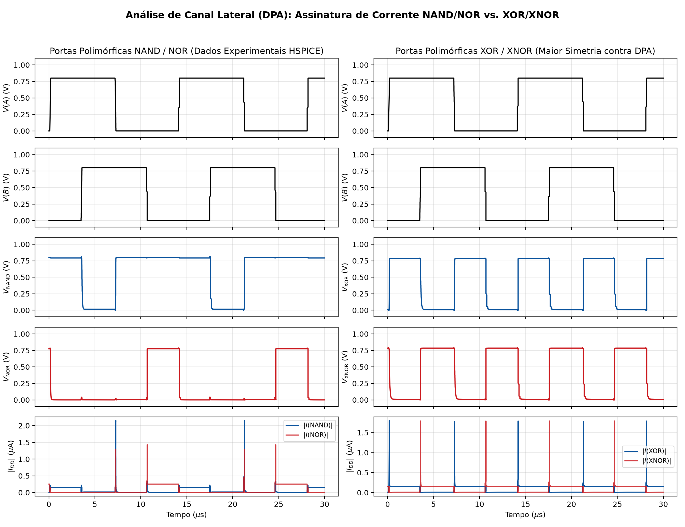
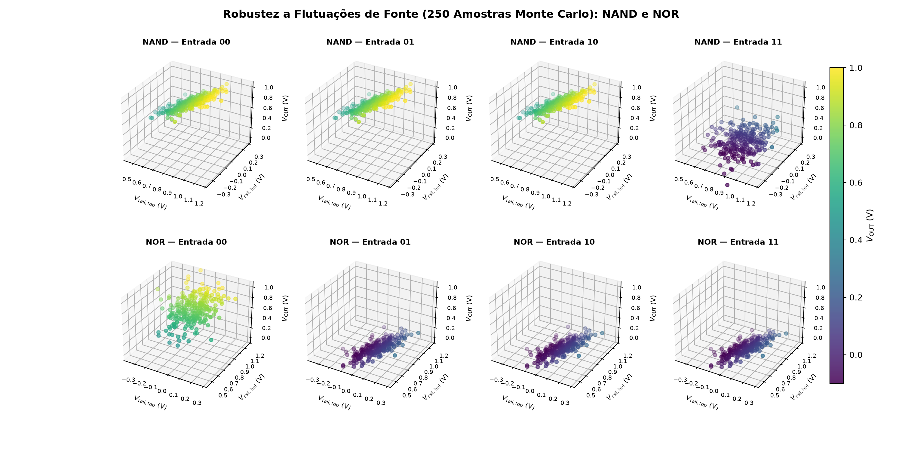
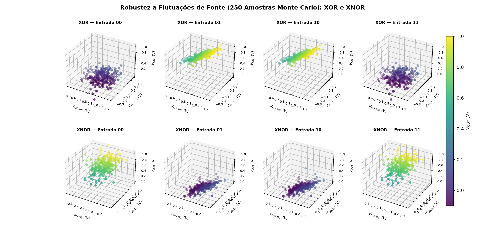
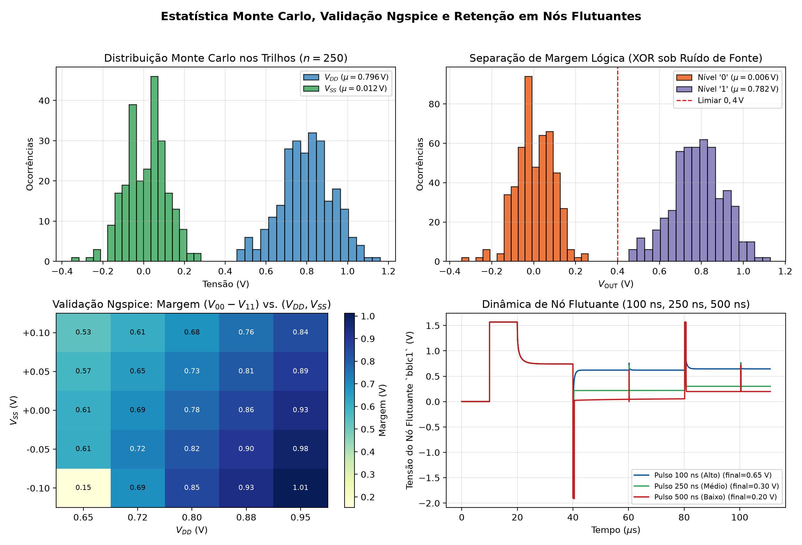

# Módulo 03 — Segurança contra Canal Lateral (DPA), Robustez 3D e Nós Flutuantes

## 1. Objetivo

Substituir integralmente os scripts proprietários em MATLAB ([m_code](../../BPFET_Nature_Electronics/m_code)) por uma rotina reproduzível em Python e validá-la com varredura paramétrica própria no `ngspice-47`, investigando três dimensões críticas de segurança e confiabilidade de circuitos BP SB-FET:
1. **Resistência a Ataques de Canal Lateral (*Differential Power Analysis* — DPA):** Comparação das assinaturas de corrente $|I(V_{DD})|$ entre portas polimórficas NAND/NOR e XOR/XNOR.
2. **Robustez a Variações nos Trilhos de Alimentação:** Análise estatística Monte Carlo (250 amostras por porta) com gráficos 3D ($V_{\text{rail,top}} \times V_{\text{rail,bot}} \times V_{\text{OUT}}$) e validação cruzada no `ngspice`.
3. **Dinâmica de Retenção em Nós Flutuantes:** Avaliação temporal até $111\ \mu\text{s}$ para diferentes larguras de pulso ($100\text{ ns}$, $250\text{ ns}$ e $500\text{ ns}$).

---

## 2. Fundamentação Teórica

- **Canal Lateral (DPA):** Em dispositivos polimórficos, as portas de polaridade conectam-se diretamente às linhas de energia ($V_{DD}$ e $V_{SS}$). Se os picos ou perfis de corrente diferirem entre a função configurada por $\text{Key}=0$ e $\text{Key}=1$, um adversário pode inferir o bit da chave monitorando a corrente de alimentação. A porta **XOR/XNOR** possui uma topologia estruturalmente simétrica entre *pull-up* e *pull-down*, equilibrando os picos de corrente independentemente da chave.
- **Robustez a Ruído de Fonte:** Oscilações nos trilhos ($V_{DD}$ e $V_{SS}$) alteram simultaneamente $V(g2, s)$ e $V(g2, d)$, afetando a altura da barreira Schottky no dreno. Simulações de Monte Carlo testam se os níveis lógicos `'0'` e `'1'` permanecem separáveis mesmo com desvios severos ($V_{DD}$ variando de $\sim 0{,}5\text{ V}$ a $1{,}15\text{ V}$ e $V_{SS}$ de $-0{,}35\text{ V}$ a $+0{,}30\text{ V}$).

---

## 3. Como Foi Feito

O script [analisar_dpa_e_robustez.py](./analisar_dpa_e_robustez.py) processa os conjuntos de dados originais do artigo e executa uma varredura de ruído no `ngspice`:
- Lê [nand_nor_waveforms.csv](../../BPFET_Nature_Electronics/m_code/nand_nor_waveforms.csv) e [xor_xnor_waveforms.csv](../../BPFET_Nature_Electronics/m_code/xor_xnor_waveforms.csv).
- Lê as 250 amostras Monte Carlo de [robustness_nand.csv](../../BPFET_Nature_Electronics/m_code/robustness_nand.csv), [robustness_nor.csv](../../BPFET_Nature_Electronics/m_code/robustness_nor.csv), [robustness_xor.csv](../../BPFET_Nature_Electronics/m_code/robustness_xor.csv) e [robustness_xnor.csv](../../BPFET_Nature_Electronics/m_code/robustness_xnor.csv).
- Gera e executa [sim_supply_noise.sp](./sim_supply_noise.sp) no `ngspice_con.exe`, varrendo $V_{DD} \in [0{,}65\text{ V}, 0{,}95\text{ V}]$ e $V_{SS} \in [-0{,}10\text{ V}, +0{,}10\text{ V}]$ em uma grade $5 \times 5$.
- Lê os arquivos de estabilidade temporal [100ns_high_floating_voltage.csv](../../BPFET_Nature_Electronics/m_code/100ns_high_floating_voltage.csv), [250ns_medium_floating_voltage.csv](../../BPFET_Nature_Electronics/m_code/250ns_medium_floating_voltage.csv) e [500ns_low_floating_voltage.csv](../../BPFET_Nature_Electronics/m_code/500ns_low_floating_voltage.csv).

### Como Reexecutar

```powershell
python "c:\Users\Plusb\Documents\tp_nano\experimentos\03_seguranca_dpa_e_robustez\analisar_dpa_e_robustez.py"
```

---

## 4. Resultados Obtidos e Análise Quantitativa

### 4.1 Métricas de Ataque de Canal Lateral DPA ([metricas_dpa.csv](./metricas_dpa.csv))

| Família Polimórfica | $I_{\text{pico}}$ Modo 0 ($\mu\text{A}$) | $I_{\text{pico}}$ Modo 1 ($\mu\text{A}$) | Diferença de Pico (%) | $I_{\text{médio}}$ Modo 0 ($\mu\text{A}$) | $I_{\text{médio}}$ Modo 1 ($\mu\text{A}$) |
| :--- | :---: | :---: | :---: | :---: | :---: |
| **NAND / NOR** | $2{,}15$ (NAND) | $1{,}43$ (NOR) | $50{,}3\%$ | $0{,}212$ | $0{,}163$ |
| **XOR / XNOR** | $1{,}80$ (XOR) | $1{,}79$ (XNOR) | **$0{,}56\%$** | $0{,}267$ | $0{,}230$ |



Na família **NAND/NOR**, os picos de corrente variam fortemente com o estado lógico e entre os modos ($2{,}15\ \mu\text{A}$ vs. $1{,}43\ \mu\text{A}$), expondo assinaturas distintas. Já na família **XOR/XNOR**, a simetria física de topologia produz picos praticamente idênticos ($1{,}80\ \mu\text{A}$ vs. $1{,}79\ \mu\text{A}$) em todas as transições simples de entrada, mascarando qual função está ativa.

### 4.2 Robustez Monte Carlo (250 Amostras por Porta — [metricas_seguranca_robustez.csv](./metricas_seguranca_robustez.csv))

| Porta | Amostras | Nível `'1'` Médio (V) | Desvio Padrão `'1'` (mV) | Nível `'0'` Médio (V) | Desvio Padrão `'0'` (mV) | Taxa de Acerto Lógico |
| :--- | :---: | :---: | :---: | :---: | :---: | :---: |
| **NAND** | $250$ | $0{,}793$ | $126{,}6$ | $0{,}038$ | $106{,}5$ | **$100{,}0\%$** |
| **NOR** | $250$ | $0{,}770$ | $118{,}0$ | $0{,}015$ | $101{,}5$ | **$100{,}0\%$** |
| **XOR** | $250$ | $0{,}782$ | $122{,}8$ | $0{,}006$ | $89{,}2$ | **$100{,}0\%$** |
| **XNOR** | $250$ | $0{,}782$ | $122{,}7$ | $0{,}006$ | $89{,}0$ | **$100{,}0\%$** |





### 4.3 Histogramas, Validação Cruzada no Ngspice e Nó Flutuante



- **Separação de Margem:** Os histogramas (acima à direita) comprovam que, mesmo com flutuações extremas nos trilhos ($V_{DD}$ entre $0{,}47\text{ e }1{,}15\text{ V}$), não há sobreposição entre os níveis lógicos `'0'` ($\mu = 0{,}006\text{ V}$) e `'1'` ($\mu = 0{,}782\text{ V}$) em torno do limiar $0{,}40\text{ V}$.
- **Validação no Ngspice ([ngspice_supply_sweep.csv](./ngspice_supply_sweep.csv)):** Em toda a grade $5 \times 5$ simulada no `ngspice`, a margem $(V_{00} - V_{11})$ da porta NAND permanece entre **$0{,}531\text{ V}$** e **$1{,}012\text{ V}$** para $V_{DD} \ge 0{,}725\text{ V}$ ou $V_{SS} \ge -0{,}05\text{ V}$, reduzindo para **$0{,}153\text{ V}$** no canto mais extremo ($V_{DD}=0{,}65\text{ V},\ V_{SS}=-0{,}10\text{ V}$).
- **Retenção em Nó Flutuante:** Após o pulso em $t = 40\ \mu\text{s}$ e $80\ \mu\text{s}$, o nó `bblc1` estabiliza em patamares bem distintos ($0{,}65\text{ V}$, $0{,}30\text{ V}$ e $0{,}20\text{ V}$ até $111\ \mu\text{s}$) de acordo com a largura do pulso ($100\text{ ns}$, $250\text{ ns}$, $500\text{ ns}$).

---

## 5. Arquivos Gerados nesta Pasta

- [analisar_dpa_e_robustez.py](./analisar_dpa_e_robustez.py) — Script unificado em Python (substitui os `.m` do MATLAB).
- [sim_supply_noise.sp](./sim_supply_noise.sp) e `sweep_*.dat` — Netlist e resultados da varredura $V_{DD} \times V_{SS}$ no `ngspice`.
- [metricas_dpa.csv](./metricas_dpa.csv), [metricas_seguranca_robustez.csv](./metricas_seguranca_robustez.csv), [ngspice_supply_sweep.csv](./ngspice_supply_sweep.csv) — Tabelas de métricas.
- `fig1_dpa_assinatura_corrente.png` a `fig4_histogramas_e_retencao.png` — Figuras geradas.

---

## 6. Conclusão

A porta polimórfica **XOR/XNOR** reduz a assimetria de pico de corrente de $50{,}3\%$ (observada em NAND/NOR) para apenas **$0{,}56\%$**, oferecendo resistência natural contra ataques DPA, enquanto todas as quatro células mantêm **$100{,}0\%$** de corretude lógica nas 250 rodadas Monte Carlo analisadas e margem de **$0{,}531\text{–}1{,}012\text{ V}$** no `ngspice` em toda a região operacional nominal ($V_{DD} \ge 0{,}725\text{ V}$ ou $V_{SS} \ge -0{,}05\text{ V}$, caindo para $0{,}153\text{ V}$ apenas no canto extremo $V_{DD}=0{,}65\text{ V},\ V_{SS}=-0{,}10\text{ V}$).
