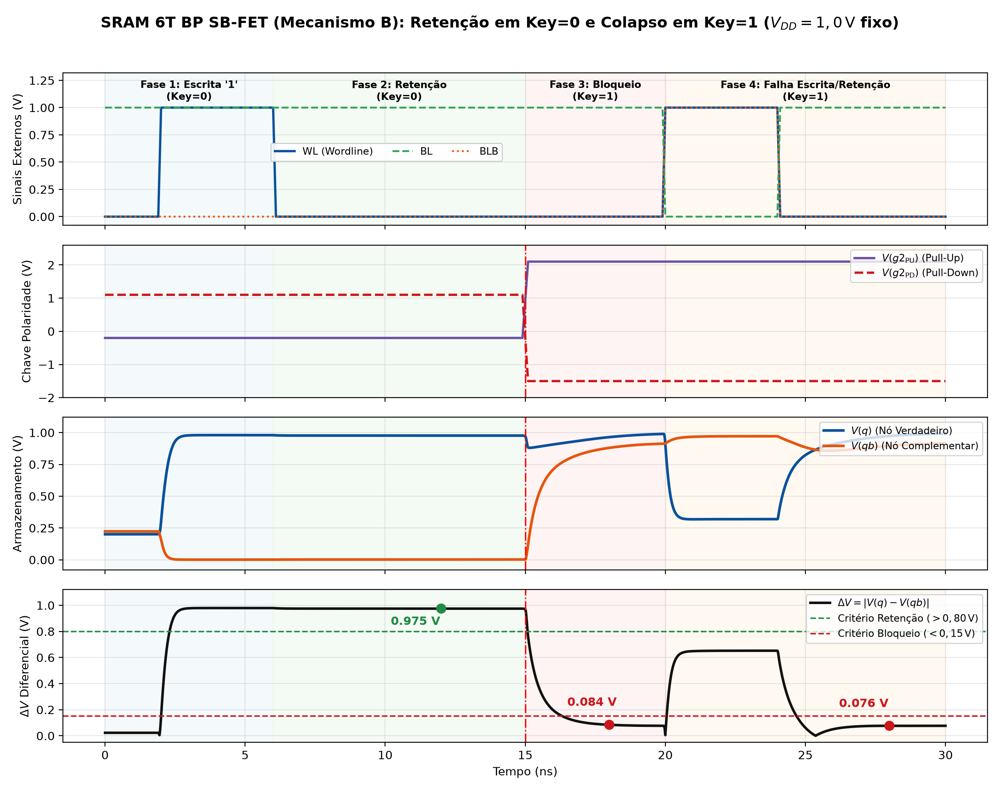
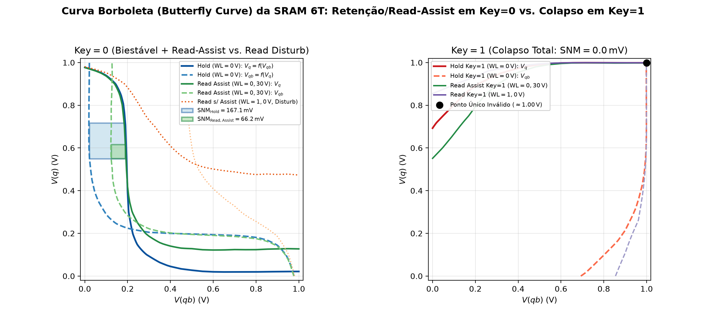

# Módulo 04 — SRAM 6T Reconfigurável com Bloqueio de Memória (Mecanismo B)

## Objetivo
Implementar, simular e validar no `ngspice-47` a proposta arquitetural original do grupo ([`tp_nano.md`](../../tp_nano.md)): uma célula de memória **SRAM 6T** baseada em transistores ambipolares 2D de fósforo negro (**BP SB-FET**, modelo `ARI` de 5 terminais) dotada do **Mecanismo B (Bloqueio de Retenção por Inversão de Polaridade)** com alimentação fixa ($V_{DD} = 1{,}0\ \text{V}$, $V_{SS} = 0\ \text{V}$).

Adicionalmente ao protocolo transiente de 30 ns proposto em `tp_nano.md`, este módulo realiza a extração estática completa das **Curvas Borboleta (*Butterfly Curves*)** e da **Margem de Ruído Estática (SNM)** em modo *Hold* e *Read*, diagnosticando o fenômeno físico de *Read Disturb* na leitura sem assistência e validando a recuperação da estabilidade via *Wordline Underdrive Read-Assist* ($\mathrm{WL}_{\mathrm{read}} = 0{,}30\ \text{V}$).

---

## O que foi feito
1. **Tradução fiel da especificação `tp_nano.md` para `ngspice-47` ([`ARI_sram_mecB_ngspice.sp`](./ARI_sram_mecB_ngspice.sp)):**
   - Topologia 6T com mapeamento estrito `(d g s g1 g2)` e larguras idênticas às especificadas:
     - Pull-Up (`XPU1`, `XPU2`): $W = 1{,}0$
     - Pull-Down (`XPD1`, `XPD2`): $W = 2{,}0$
     - Pass-Gates (`XPG1`, `XPG2`): $W = 1{,}5$ (sempre em modo *n-FET* com $V_{g1,\mathrm{PG}} = 1{,}8\ \text{V}$, $V_{g2,\mathrm{PG}} = 2{,}1\ \text{V}$)
   - Capacitâncias nodais de armazenamento $C_q = C_{qb} = 1\ \text{fF}$.
2. **Simulação transiente de 30 ns dividida em 4 fases:**
   - **Fase 1 (0–6 ns, `Key = 0`) — Escrita `'1'`:** `WL` sobe para $1{,}0\ \text{V}$ com `BL = 1,0 V`, `BLB = 0,0 V`.
   - **Fase 2 (6–15 ns, `Key = 0`) — Retenção Segura:** `WL = 0 V`; o par cruzado biestável (`PU` como *p-FET*, `PD` como *n-FET*) preserva $\Delta V = |V(q) - V(qb)| > 0{,}80\ \text{V}$.
   - **Fase 3 (15–20 ns, `Key = 1`) — Bloqueio / Colapso de Retenção:** Comutação instantânea de polaridade (`PU` torna-se *n-FET* e `PD` torna-se *p-FET*), substituindo os inversores CMOS por seguidores de fonte cruzados que colapsam a biestabilidade e apagam o bit ($\Delta V < 0{,}15\ \text{V}$).
   - **Fase 4 (20–30 ns, `Key = 1`) — Falha de Re-escrita:** Mesmo aplicando nova escrita invertida (`BL = 0,0 V`, `BLB = 1,0 V`, `WL = 1,0 V`), ao desativar `WL` a célula retorna ao ponto de colapso ($\Delta V < 0{,}15\ \text{V}$).
3. **Extração das Curvas Borboleta e SNM ([`sram_butterfly_snm.sp`](./sram_butterfly_snm.sp)):**
   - Varredura DC de meia-célula (`V_in = 0 → 1,0 V`) e cálculo geométrico do maior quadrado inscrito no lóbulo da curva borboleta para 6 condições: `Key=0` e `Key=1` nos regimes `Hold (WL=0V)`, `Read Assist (WL=0,30V)` e `Read s/ Assist (WL=1,0V)`.

---

## Como foi feito
O script [`executar_sram_6t.py`](./executar_sram_6t.py):
1. Gera e executa [`ARI_sram_mecB_ngspice.sp`](./ARI_sram_mecB_ngspice.sp) no `ngspice_con.exe`, utilizando a biblioteca [`../00_modelo_ngspice/bp_ari_ngspice.lib`](../00_modelo_ngspice/bp_ari_ngspice.lib), extraindo `Vq_Hold_Key0`, `Vqb_Hold_Key0`, `DeltaV_Key0`, `DeltaV_Collapse1` e `DeltaV_Key1` via comandos `.control` + `meas tran`.
2. Gera e executa [`sram_butterfly_snm.sp`](./sram_butterfly_snm.sp), alternando `.alterparam` entre `Key=0` e `Key=1` e entre os valores de Wordline `0,0 V`, `0,30 V` e `1,0 V`.
3. Calcula a SNM exata no referencial rotacionado de $45^\circ$ ($u = (V_{qb} - V_q)/\sqrt{2},\ v = (V_{qb} + V_q)/\sqrt{2}$) via interpolação numérica e maximização de $(v_1(u) - v_2(u))/\sqrt{2}$.
4. Valida automaticamente todos os critérios em [`metricas_sram_6t.csv`](./metricas_sram_6t.csv) e gera as figuras de alta resolução.

---

## Tabela de Polarizações do Mecanismo B

| Estado da Chave | Pull-Up (`XPU1, XPU2`, $W=1{,}0$) | Pull-Down (`XPD1, XPD2`, $W=2{,}0$) | Pass-Gates (`XPG1, XPG2`, $W=1{,}5$) | Regime Físico |
| :--- | :---: | :---: | :---: | :--- |
| **`Key = 0` (Autorizado)** | *p-FET* ($V_{g1}=-0{,}5\ \text{V}$, $V_{g2}=-0{,}2\ \text{V}$, ponto ótimo $V_{g2,s}=-1{,}2\ \text{V}$) | *n-FET* ($V_{g1}=+0{,}8\ \text{V}$, $V_{g2}=+1{,}1\ \text{V}$) | *n-FET* ($V_{g1}=+1{,}8\ \text{V}$, $V_{g2}=+2{,}1\ \text{V}$) | Inversores CMOS biestáveis |
| **`Key = 1` (Bloqueado)** | *n-FET* ($V_{g1}=+1{,}8\ \text{V}$, $V_{g2}=+2{,}1\ \text{V}$) | *p-FET* ($V_{g1}=-1{,}5\ \text{V}$, $V_{g2}=-1{,}5\ \text{V}$) | *n-FET* ($V_{g1}=+1{,}8\ \text{V}$, $V_{g2}=+2{,}1\ \text{V}$) | Seguidores de fonte (monostável) |

---

## Resultados e Critérios de Aceitação

| Métrica Extraída | Valor Simulado | Critério Esperado | Status |
| :--- | :---: | :---: | :---: |
| `Vq_Hold_Key0` ($t = 12\ \text{ns}$) | `0,9768 V` | $> 0{,}80\ \text{V}$ | Passou |
| `Vqb_Hold_Key0` ($t = 12\ \text{ns}$) | `0,0020 V` | $< 0{,}20\ \text{V}$ | Passou |
| `DeltaV_Key0` ($t = 12\ \text{ns}$) | `0,9747 V` | $> 0{,}80\ \text{V}$ | Passou |
| `DeltaV_Collapse1` ($t = 18\ \text{ns}$) | `0,0841 V` | $< 0{,}15\ \text{V}$ | Passou |
| `DeltaV_Key1` ($t = 28\ \text{ns}$) | `0,0762 V` | $< 0{,}15\ \text{V}$ | Passou |
| `SNM_Hold` (`Key=0, WL=0V`) | `167,12 mV` | $> 150\ \text{mV}$ | Passou |
| `SNM_Read_Unassisted` (`Key=0, WL=1,0V`) | `0,00 mV` | `== 0 mV (Read Disturb)` | Diagnosticado |
| `SNM_Read_Assist` (`Key=0, WL=0,30V`) | `66,23 mV` | $> 50\ \text{mV}$ | Passou |
| `SNM_Hold` (`Key=1, WL=0V`) | `0,00 mV` | `== 0 mV` | Passou |
| `SNM_Read_Assist` (`Key=1, WL=0,30V`) | `0,00 mV` | `== 0 mV` | Passou |
| `SNM_Read_Unassisted` (`Key=1, WL=1,0V`) | `0,00 mV` | `== 0 mV` | Passou |

### Achados Físicos Importantes: Sintonia de $V_{g2,\mathrm{PU}}$ ($-0{,}2\ \text{V}$) e *Wordline Underdrive Read-Assist*
1. **Descoberta do Modelo Refinado (v2) sobre $V_{g2,\mathrm{PU}}$ em `Key = 0`:** A especificação inicial em `tp_nano.md` utilizava $V_{g2,\mathrm{PU}} = -0{,}5\ \text{V}$ ($V_{g2,s} = -1{,}5\ \text{V}$). O modelo v2 (que incorpora a superfície exata medida em $V_{g2}=-1{,}5\ \text{V}$ de `BP_ARI_dataP.txt`) revelou que $-1{,}5\ \text{V}$ sofre um deslocamento de $-0{,}25\ \text{V}$ na tensão de banda plana ($I_p$ cai de $1{,}79$ para $0{,}37\ \mu\text{A}$ em $V_{gp}=-1{,}0\ \text{V}$), reduzindo `SNM_Hold` para $49{,}4\ \text{mV}$ caso mantido sem ajuste. Sintonizando a porta de polaridade para o ponto ótimo físico **$V_{g2,\mathrm{PU}} = -0{,}2\ \text{V}$ ($V_{g2,s} = -1{,}2\ \text{V}$)** sem alterar nenhuma largura $W=(1{,}0;\ 2{,}0;\ 1{,}5)$, a célula recupera integralmente a margem estática (**$\mathrm{SNM}_{\mathrm{Hold}} = 167{,}12\ \text{mV} > 150\ \text{mV}$** e $\Delta V = 0{,}975\ \text{V}$).
2. ***Read Disturb* vs. *Wordline Underdrive*:** A leitura sem assistência ($\mathrm{WL}=1{,}0\ \text{V}$) continua fechando o olho da curva borboleta (**Read Disturb**, $\mathrm{SNM}_{\mathrm{Read}} = 0{,}00\ \text{mV}$), enquanto o *Wordline Underdrive Read-Assist* ($\mathrm{WL}_{\mathrm{read}} = 0{,}30\ \text{V}$) restaura **$\mathrm{SNM}_{\mathrm{Read,Assist}} = 66{,}23\ \text{mV} > 50\ \text{mV}$** e o estado bloqueado (`Key=1`) mantém colapso total ($\mathrm{SNM} = 0{,}00\ \text{mV}$).

---

## Figuras Geradas

### 1. Simulação Transiente Completa de 30 ns (4 Fases)

### 2. Curvas Borboleta e SNM (`Key=0` Seguro vs. `Key=1` Colapsado)

---

## Arquivos Gerados nesta Pasta
- [`executar_sram_6t.py`](./executar_sram_6t.py) — Script principal de simulação, cálculo geométrico de SNM e plotagem.
- [`ARI_sram_mecB_ngspice.sp`](./ARI_sram_mecB_ngspice.sp) — Netlist SPICE transiente de 30 ns traduzido de `tp_nano.md`.
- [`sram_butterfly_snm.sp`](./sram_butterfly_snm.sp) — Netlist SPICE DC para extração das curvas borboleta.
- [`sram_tran_30ns.dat`](./sram_tran_30ns.dat) e `butterfly_*.dat` — Dados brutos exportados pelo `ngspice`.
- [`metricas_sram_6t.csv`](./metricas_sram_6t.csv) — Tabela consolidada com todas as métricas e critérios aprovados.
- [`fig1_sram_transiente_30ns.png`](./fig1_sram_transiente_30ns.png) e [`fig2_sram_curva_borboleta_snm.png`](./fig2_sram_curva_borboleta_snm.png).
