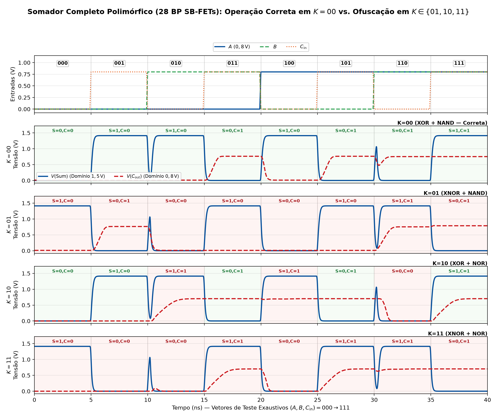
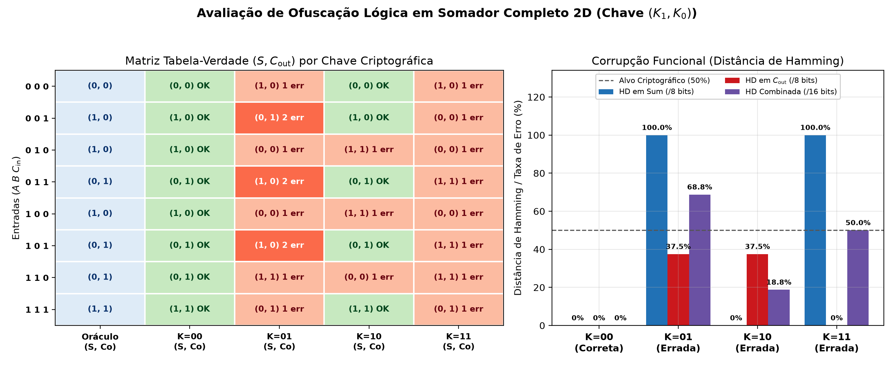

# Módulo 05 — Circuito Combinacional Criptográfico: Somador Completo Polimórfico (2-bit Key)

## Objetivo
Demonstrar a escalabilidade da lógica polimórfica ambipolar **BP SB-FET** do nível de porta isolada (Módulo 02) para um **circuito combinacional aritmético multiestágio** completo: um **Somador Completo de 1 bit (*1-bit Full Adder*)** com **ofuscação lógica em tempo de execução (*Logic Locking*) controlada por chave de 2 bits $(K_1, K_0)$**, simulado integralmente no `ngspice-47`.

---

## O que foi feito
1. **Arquitetura multiestágio com 28 transistores BP SB-FET (`full_adder_polimorfico.sp`):**
   - **Estágio 1 — Porta `XXOR1` polimórfica (4 transistores):** Calcula o sinal intermediário $P$:
     - $K_0 = 0 \implies P = A \oplus B$ (`XOR`)
     - $K_0 = 1 \implies P = A \odot B$ (`XNOR`)
   - **Condicionamento e conversão de nível (4 inversores `BP_INV08` e `BP_INV11`, 8 transistores):** Regenera as saídas complementares $(P, \overline{P})$ em $0{,}8\ \text{V}$ para alimentar a árvore de *Carry-Out* e em $1{,}1\ \text{V}$ para acionar a porta de polaridade da segunda `XOR`.
   - **Estágio 2 — Porta `XXOR2` (`XOR`, 4 transistores):** Gera a soma final $\mathrm{Sum} = P \oplus C_{\mathrm{in}}$ em domínio $1{,}5\ \text{V}$.
   - **Estágio 3 — Árvore de transporte *Carry-Out* (`XG1, XG2, XG3`, 12 transistores):** Realiza $C_{\mathrm{out}} = G_3\big(G_1(A, B),\ G_2(P, C_{\mathrm{in}})\big)$, em que $K_1$ chaveia todas as 3 portas entre:
     - $K_1 = 0 \implies$ `NAND` ($\overline{A\cdot B}\ \mathrm{NAND}\ \overline{P\cdot C_{\mathrm{in}}} = A\cdot B + C_{\mathrm{in}}\cdot(A\oplus B)$)
     - $K_1 = 1 \implies$ `NOR` (estrutura dual)
2. **Varredura exaustiva das 4 chaves criptográficas $\times$ 8 mintermos ($000 \rightarrow 111$):**
   - Simulação transiente de $40\ \text{ns}$ ($5\ \text{ns}$ por vetor de entrada) para todas as combinações $K_1 K_0 \in \{00, 01, 10, 11\}$ utilizando comandos `.alterparam` no `ngspice`.
3. **Extração automatizada de margens analógicas e Distância de Hamming (HD):**
   - Quantificação da taxa de corrupção funcional em `Sum`, `Cout` e combinada (16 bits por chave).

---

## Como foi feito
O script [`executar_full_adder.py`](./executar_full_adder.py):
1. Gera [`full_adder_polimorfico.sp`](./full_adder_polimorfico.sp) importando [`../00_modelo_ngspice/bp_ari_ngspice.lib`](../00_modelo_ngspice/bp_ari_ngspice.lib).
2. Executa as 4 simulações em lote no `ngspice_con.exe`, salvando `fa_k00.dat` a `fa_k11.dat`.
3. Amostra as tensões estabilizadas na segunda metade de cada janela de $5\ \text{ns}$ ($t \in [5i+3{,}5,\ 5i+4{,}8]\ \text{ns}$), binariza com limiares $0{,}75\ \text{V}$ para `Sum` e $0{,}40\ \text{V}$ para `Cout`, exporta todas as 32 linhas para [`tabelas_verdade_full_adder.csv`](./tabelas_verdade_full_adder.csv) e valida automaticamente as margens e a ofuscação.

---

## Resultados e Análise de Segurança Lógica

### Margens Analógicas na Chave Autorizada (`K1K0 = 00`)
- **`Sum` (domínio $1{,}5\ \text{V}$):** `'0'` $\le 0{,}0012\ \text{V}$ e `'1'` $\ge 1{,}4129\ \text{V}$ (excursão útil $> 94\%$, cascateamento integral após 2 estágios).
- **`Cout` (domínio $0{,}8\ \text{V}$):** `'0'` $\le 0{,}0124\ \text{V}$ e `'1'` $\ge 0{,}7526\ \text{V}$ (profundidade lógica de 3 níveis cascateados com excursão $> 92\%$).

### Distância de Hamming por Chave $(K_1, K_0)$

| Chave $K_1 K_0$ | Configuração (`XXOR1` + Árvore `Cout`) | Erros `Sum` (/8) | HD `Sum` | Erros `Cout` (/8) | HD `Cout` | HD Combinada (/16) | Acurácia Full Adder |
| :---: | :--- | :---: | :---: | :---: | :---: | :---: | :---: |
| **`00` (Correta)** | `XOR` + `NAND` | `0` | `0,0%` | `0` | `0,0%` | `0 (0,00%)` | **`100,00%`** |
| **`01` (Errada)** | `XNOR` + `NAND` | `8` | `100,0%` | `3` | `37,5%` | `11 (68,75%)` | `31,25%` |
| **`10` (Errada)** | `XOR` + `NOR` | `0` | `0,0%` | `3` | `37,5%` | `3 (18,75%)` | `81,25%` |
| **`11` (Errada)** | `XNOR` + `NOR` | `8` | `100,0%` | `0` | `0,0%` | `8 (50,00%)` | `50,00%` |

### Interpretação Física e Algébrica (*De Morgan Duality*)
- Em **`K = 01`**, a inversão do nó intermediário $P \rightarrow \overline{P}$ propaga erros tanto para `Sum` ($100\%$ invertida) quanto para a árvore de transporte ($37{,}5\%$ de erro em `Cout`), atingindo **`68,75%`** de bits totais corrompidos (`11/16`).
- Em **`K = 10`**, `Sum` permanece intacta enquanto a comutação `NAND` $\rightarrow$ `NOR` corrompe $37{,}5\%$ dos vetores de `Cout`.
- Em **`K = 11`**, observa-se uma propriedade algébrica interessante de dualidade de De Morgan: quando `XXOR1` vira `XNOR` ($\overline{P}$) e `XG1..XG3` viram `NOR`, tem-se $\overline{\overline{A+B} + \overline{\overline{P}+C_{\mathrm{in}}}} = (A+B)\cdot(\overline{P}+C_{\mathrm{in}}) = A\cdot B + C_{\mathrm{in}}\cdot(A\oplus B)$, restaurando `Cout` enquanto **`Sum` permanece `100%` invertida** ($\mathrm{HD}_{\mathrm{Sum}} = 8/8$, $\mathrm{HD}_{\mathrm{Total}} = 50{,}0\%$). Todas as chaves erradas corrompem a função aritmética sem exigir área adicional de chaves MUX ou portas XNOR extras dedicadas ao travamento.

---

## Figuras Geradas

### 1. Formas de Onda Transientes Exaustivas ($000 \rightarrow 111$) nas 4 Chaves

### 2. Matriz de Tabela-Verdade e Distância de Hamming por Chave

---

## Arquivos Gerados nesta Pasta
- [`executar_full_adder.py`](./executar_full_adder.py) — Script principal de simulação multi-chave, binarização e métricas de Hamming.
- [`full_adder_polimorfico.sp`](./full_adder_polimorfico.sp) — Netlist SPICE completo de 28 transistores com `.alterparam` para `00`, `01`, `10` e `11`.
- `fa_k00.dat` .. `fa_k11.dat` — Formas de onda exportadas pelo `ngspice`.
- [`tabelas_verdade_full_adder.csv`](./tabelas_verdade_full_adder.csv) — Tabela detalhada com todos os 32 pontos simulados ($4\ \text{chaves} \times 8\ \text{mintermos}$).
- [`fig1_full_adder_waveforms.png`](./fig1_full_adder_waveforms.png) e [`fig2_matriz_tabelas_verdade_hamming.png`](./fig2_matriz_tabelas_verdade_hamming.png).
