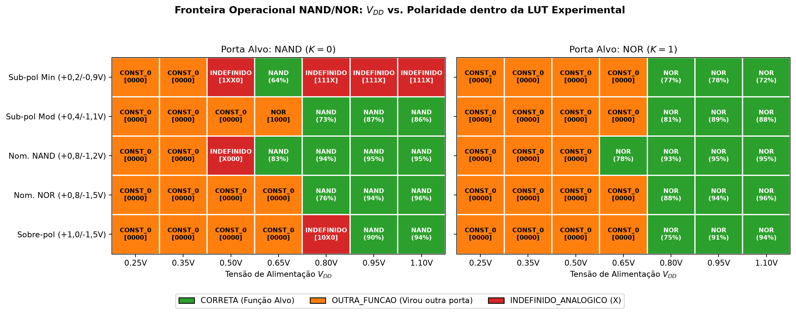
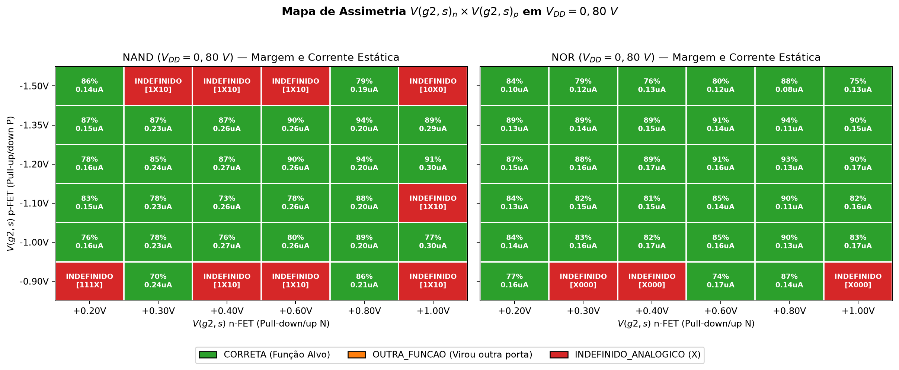
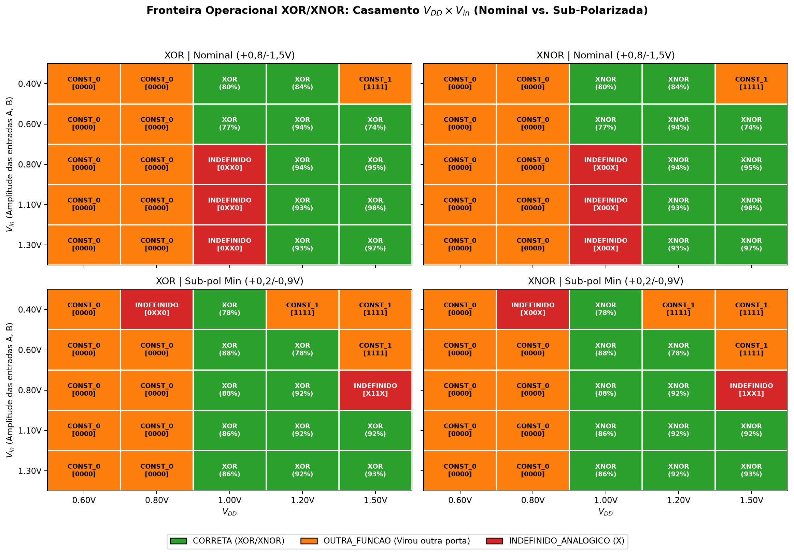

# Módulo 06 — Fronteira Operacional sob Tensões Não-Padronizadas

## 1. Objetivo

Investigar diretamente no `ngspice-47` a hipótese levantada pelo grupo: **quando um circuito polimórfico BP SB-FET recebe tensões fora do ponto nominal (`VDD`, `Vin` e `V(g2,s)`), ele passa a se comportar como a função dual, vira outra função booleana ou entra em estado intermediário indefinido?**

> **Rigor Metodológico com os Dados Experimentais:** Todas as varreduras deste módulo mantêm os terminais estritamente dentro do domínio efetivamente medido em [BP_ARI_dataN.txt](../../BPFET_Nature_Electronics/BP_SBFET_MODEL/BP_ARI_dataN.txt) e [BP_ARI_dataP.txt](../../BPFET_Nature_Electronics/BP_SBFET_MODEL/BP_ARI_dataP.txt): $V(g2,s)_n \in [+0{,}20;\ +1{,}00]\text{ V}$ e $V(g2,s)_p \in [-1{,}50;\ -0{,}90]\text{ V}$. A faixa não medida $(-0{,}90;\ +0{,}20)\text{ V}$ é propositalmente evitada para não confundir extrapolação numérica de tabela com física ambipolar.

---

## 2. Como Foi Feito

O script [executar_varredura_tensoes.py](./executar_varredura_tensoes.py) monta três varreduras parametrizadas em escada PWL contendo 4 células paralelas (`00`, `01`, `10`, `11`) por circuito:

1. **NAND/NOR — Grade `VDD × Polaridade` ([sweep_nand_nor_vdd_pol.sp](./sweep_nand_nor_vdd_pol.sp)):** `7` níveis de $V_{DD} \in \{0{,}25;\ 0{,}35;\ 0{,}50;\ 0{,}65;\ 0{,}80;\ 0{,}95;\ 1{,}10\}\text{ V}$ × `5` pares de polaridade na LUT, sob `Key = 0` (NAND) e `Key = 1` (NOR) (`70` pontos).
2. **NAND/NOR — Assimetria `V(g2,s)_n × V(g2,s)_p` ([sweep_nand_nor_asym.sp](./sweep_nand_nor_asym.sp)):** grade `6 × 6` em $V_{DD} = 0{,}80\text{ V}$ para `Key = 0` e `Key = 1` (`72` pontos).
3. **XOR/XNOR — Descasamento `VDD × Vin` ([sweep_xor_xnor_vdd_vin.sp](./sweep_xor_xnor_vdd_vin.sp)):** `5` níveis de $V_{DD} \in \{0{,}60..1{,}50\}\text{ V}$ × `5` amplitudes de entrada $V_{in} \in \{0{,}40..1{,}30\}\text{ V}$ sob polaridade nominal e sub-polarizada, além do caso com porta fixa `Vg_p = 0 V` em $V_{DD} \in [0{,}90..1{,}50]\text{ V}$ (`150` pontos).

Cada saída normalizada $V_{\text{out}}/V_{DD}$ é classificada em `'1'` ($\ge 0{,}75$), `'0'` ($\le 0{,}25$) ou `'X'` ($0{,}25 < V/V_{DD} < 0{,}75$), separando o comportamento em:
- **`CORRETA`**: tabela-verdade idêntica à função alvo.
- **`OUTRA_FUNCAO`**: níveis digitais válidos (`'0'`/`'1'`), mas realizando outra função booleana.
- **`INDEFINIDO_ANALOGICO`**: ao menos uma combinação de entrada estabiliza na região analógica proibida (`X`).

### Como Reexecutar

```powershell
.\.venv\Scripts\python.exe "c:\Users\Plusb\Documents\tp_nano\experimentos\06_fronteira_tensao_nao_padronizada\executar_varredura_tensoes.py"
```

---

## 3. Resultados Obtidos

### 3.1 Porta Polimórfica NAND/NOR: Transição para `NOR`, `CONST_0` e `X`



- **Conversão Espontânea `NAND → NOR` sem troca de chave:** No ponto $V_{DD} = 0{,}65\text{ V}$ com sub-polarização moderada (`+0,4/-1,1 V`), a porta configurada como **NAND (`Key=0`)** produz `[1000]` ($V_{00}=0{,}5412\text{ V}$, $V_{01}=0{,}1073\text{ V}$, $V_{10}=0{,}1410\text{ V}$, $V_{11}=0{,}0206\text{ V}$) — ou seja, **comporta-se exatamente como a versão dual NOR**. Fisicamente, em `01` e `10`, apenas um p-FET enfraquecido puxa para cima a $-0{,}65\text{ V}$ enquanto a rede série n-FET em sub-polarização `+0,4 V` conduz fuga suficiente para puxar a saída para baixo; somente em `00` (dois p-FETs em paralelo) o *pull-up* vence.
- **Colapso para `CONST_0` em baixa tensão ($V_{DD} \le 0{,}50\text{ V}$):** `34` dos `70` pontos degeneram para `0000` (`CONST_0`), pois $|V_{gs}|$ fica abaixo da tensão efetiva de condução p-FET enquanto o ramo n-FET mantém condução residual.
- **Assimetria `V(g2,s)_n × V(g2,s)_p` em $V_{DD} = 0{,}80\text{ V}$:**



- Na [fig2_nand_nor_assimetria_vg2.png](./fig2_nand_nor_assimetria_vg2.png), `60` de `72` pontos operam corretamente e `12` entram em `INDEFINIDO_ANALOGICO` (`[1X10]`, `[10X0]`, `[111X]`, `[X000]`).
- Destaca-se a faixa **não-monotônica** em $V(g2,s)_p = -1{,}50\text{ V}$ na NAND: devido ao deslocamento de banda plana ($\Delta V_{fb} \approx -0{,}25\text{ V}$) medido na tabela p-FET, $V_{01}$ colapsa para nível intermediário (`0,163–0,496 V`) em quase todas as colunas n-FET (exceto $+0{,}20$ e $+0{,}80\text{ V}$), ao passo que $V(g2,s)_p \in \{-1{,}35;\ -1{,}20\}\text{ V}$ acerta `100%` das combinações n-FET.

### 3.2 Porta Polimórfica XOR/XNOR: Inversão de Travamento entre `CONST_0` e `CONST_1`



Nos `150` pontos simulados em [mapa_tensoes_xor_xnor.csv](./mapa_tensoes_xor_xnor.csv) (`88 CORRETA`, `52 OUTRA_FUNCAO`, `10 INDEFINIDO_ANALOGICO`):

- **$V_{DD}$ baixo (`0,60–0,80 V`) → `CONST_0 [0000]` (`38` casos):** O *pull-up* p-FET não atinge *overdrive* suficiente e todas as saídas caem para `'0'`.
- **$V_{DD}$ alto com $V_{in}$ baixo (`VDD = 1,50 V, Vin = 0,40 V` ou `0,60 V` sub-pol) → `CONST_1 [1111]` (`14` casos):** O *pull-up* p-FET tem $1{,}5\text{ V}$ de polarização contra apenas $0{,}4\text{ V}$ no *pull-down* n-FET, dominando inclusive os estados `00`/`11` ($V_{\text{out}} \ge 1{,}4154\text{ V}$) e gerando corrente estática elevada (`0,536–1,222 uA`).
- **Zona de transição intermediária (`VDD = 1,00 V, Vin ≥ 0,80 V` nominal; `VDD = 1,50 V, Vin = 0,80 V` sub-pol):** A porta entra em regime analógico indefinido (`[0XX0]`, `[X00X]`, `[X11X]`, `[1XX1]`) com saída estacionária em `0,49–0,72 V`.
- **Compensação pela porta de polaridade:** Em $V_{DD} = 1{,}00\text{ V}$, a polarização nominal (`+0,8/-1,5 V`) falha para $V_{in} \ge 0{,}80\text{ V}$, enquanto a sub-polarização (`+0,2/-0,9 V`) restaura a operação correta de `XOR/XNOR` com margem de `86–88%` devido ao ajuste favorável de $V_{fb}$.

---

## 4. Arquivos Gerados nesta Pasta

- [executar_varredura_tensoes.py](./executar_varredura_tensoes.py) — Gerador de netlists, simulador `ngspice` e classificador booleano.
- [sweep_nand_nor_vdd_pol.sp](./sweep_nand_nor_vdd_pol.sp), [sweep_nand_nor_asym.sp](./sweep_nand_nor_asym.sp), [sweep_xor_xnor_vdd_vin.sp](./sweep_xor_xnor_vdd_vin.sp) — Netlists parametrizadas.
- [mapa_tensoes_nand_nor.csv](./mapa_tensoes_nand_nor.csv) e [mapa_tensoes_xor_xnor.csv](./mapa_tensoes_xor_xnor.csv) — Tabelas completas com todas as `292` condições simuladas.
- `fig1_nand_nor_mapa_vdd_polaridade.png` a `fig3_xor_xnor_mapa_vdd_vin.png` — Mapas de fase operacionais.

---

## 5. Conclusão

Sob tensões fora do ponto nominal (mantidas dentro dos limites experimentais da LUT), os circuitos polimórficos BP SB-FET **podem exibir todos os três desfechos previstos na hipótese do grupo**: preservam a função alvo em uma janela robusta ($V_{DD} \ge 0{,}80\text{ V}$ em NAND/NOR e $1{,}20\text{–}1{,}50\text{ V}$ casado em XOR/XNOR), **convertem-se pontualmente na outra função dual** (`NAND → NOR` em $V_{DD} = 0{,}65\text{ V}$, `+0,4/-1,1 V`) ou travam em funções degeneradas (`CONST_0` em sub-tensão e `CONST_1` por *overdrive* assimétrico em XOR/XNOR), e atravessam **faixas analógicas indefinidas (`X`)** exatamente nas fronteiras entre um regime e outro.
