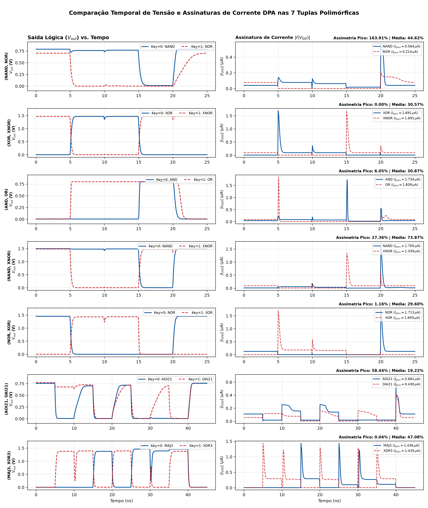
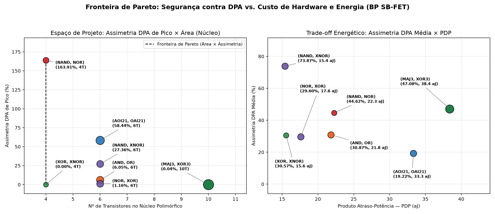
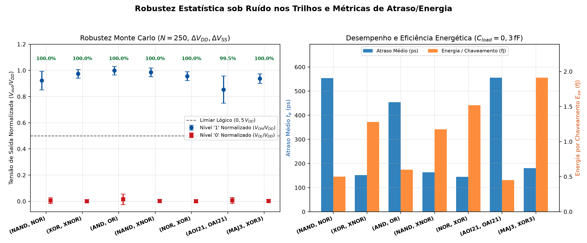
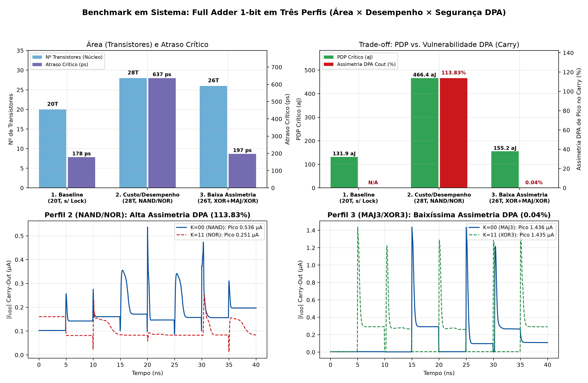

# Módulo 07 — Assimetria de Potência (DPA) vs. Custo de Hardware em Tuplas Polimórficas BP SB-FET

## 1. Objetivo

Mapear sistematicamente no `ngspice-47` (utilizando a biblioteca [bp_ari_ngspice.lib](../00_modelo_ngspice/bp_ari_ngspice.lib)) o *trade-off* entre **segurança física contra ataques por canal lateral (assimetria DPA)**, **custo de hardware** (número de transistores BP SB-FET e soma de larguras $\sum W$), **desempenho/eficiência energética** (atraso médio $t_p$, potência estática e média, energia por chaveamento $E_{\text{sw}}$ e $\text{PDP}$) e **robustez estatística** (Monte Carlo $N=250$ sobre grade real de ruído nos trilhos) em **7 tuplas de portas lógicas polimórficas** propostas em [proposta_assimetria_tuplas.md](../proposta_assimetria_tuplas.md).

Como validação em circuito aritmético completo, o módulo também executa um **Benchmark em Sistema com três perfis arquiteturais de Full Adder 1-bit**, quantificando o custo real em área, atraso e $\text{PDP}$ para proteger o caminho de *carry* contra ataques DPA.

---

## 2. Tuplas Avaliadas e Metodologia de Testbench Padronizado

Todas as 7 tuplas foram simuladas sob a mesma carga capacitiva de saída ($C_{\text{load}} = 0{,}3\ \text{fF}$), com alimentação nominal correspondente à família topológica ($V_{DD} = 0{,}8\ \text{V}$ para redes *pull-up*/*pull-down* em estilo CMOS complementar; $V_{DD} = 1{,}5\ \text{V}$ com entradas $V_{\text{in}} = 1{,}1\ \text{V}$ para topologias simétricas baseadas em *pass-transistor* / controle dual-rail) e rotina padronizada de extração de corrente na alimentação $|I(V_{DD})|$ em ambos os modos ($\text{Key}=0$ e $\text{Key}=1$):

1. **Testbench de 2 entradas ([tuplas_2entradas.sp](./tuplas_2entradas.sp)):** Ciclo de $25\ \text{ns}$ percorrendo `00 → 01 → 10 → 11 → 00` em `Key=0` e `Key=1` (garantindo transições `0→1` e `1→0` em todas as portas) para **`(NAND, NOR)`**, **`(XOR, XNOR)`**, **`(AND, OR)`**, **`(NAND, XNOR)`** e **`(NOR, XOR)`**.
2. **Testbench de 3 entradas ([tuplas_3entradas.sp](./tuplas_3entradas.sp)):** Ciclo de $45\ \text{ns}$ percorrendo `000 → … → 111 → 000` em `Key=0` e `Key=1` para **`(AOI21, OAI21)`** ($6\text{T}$) e **`(MAJ3, XOR3)`** (estágio polimórfico $10\text{T}$ com MUX local em transistores; $18\text{T}$ incluindo gerador $P = A \oplus B$).
3. **Varredura de ruído e Monte Carlo ([sim_robustez_tuplas.sp](./sim_robustez_tuplas.sp)):** Grade $3 \times 3$ no `ngspice` variando $\Delta V_{DD} \in \{-10\%, 0\%, +10\%\}$ e $\Delta V_{SS} \in \{-50\ \text{mV}, 0\ \text{mV}, +50\ \text{mV}\}$, seguida de avaliação Monte Carlo gaussiana ($N = 250$, $\sigma_{V_{DD}} = 3{,}5\%$, $\sigma_{V_{SS}} = 18\ \text{mV}$).
4. **Benchmark Full Adder em 3 Perfis ([full_adder_perfis_dpa.sp](./full_adder_perfis_dpa.sp)):** Comparação exaustiva nos 8 mintermos `(000..111)` em $40\ \text{ns}$ sob $C_{\text{load}} = 0{,}3\ \text{fF}$.

A assimetria DPA relativa segue a métrica padronizada do Módulo 03:
$$\text{DPA}_{\text{asym}} = \frac{|I_{\text{Modo 0}} - I_{\text{Modo 1}}|}{\min(I_{\text{Modo 0}},\ I_{\text{Modo 1}})} \times 100\%$$

### Como Reexecutar

```powershell
python "c:\Users\Plusb\Documents\tp_nano\experimentos\07_assimetria_tuplas_logicas\executar_assimetria_tuplas.py"
```

---

## 3. Resultados das 7 Tuplas Polimórficas

### 3.1 Tabela Consolidada de Segurança DPA, Área, Desempenho e Robustez ([metricas_tuplas_dpa.csv](./metricas_tuplas_dpa.csv))

Todas as **72 combinações** de entrada e chave avaliadas em [tabelas_verdade_tuplas.csv](./tabelas_verdade_tuplas.csv) obtiveram **100,0% de corretude funcional** (`V1_min >= 0,6792 V` a `0,8 V` e `>= 1,3767 V` a `1,5 V`; `V0_max <= 0,0128 V`).

| Tupla | Categoria | Núcleo / Total | $\sum W$ ($\mu\text{m}$) | $V_{DD}$ (V) | $I_{\text{pico}}$ M0 / M1 ($\mu\text{A}$) | **DPA Pico (%)** | **DPA Média (%)** | Atraso $t_p$ (ps) | $P_{\text{méd}}$ (nW) | $E_{\text{sw}}$ (fJ) | PDP (aJ) | Acerto MC ($N=250$) |
| :--- | :--- | :---: | :---: | :---: | :---: | :---: | :---: | :---: | :---: | :---: | :---: | :---: |
| **`(NAND, NOR)`** | Universal Compacta | `4T` / `4T` | $6{,}0$ | $0{,}8$ | $0{,}5643$ / $0{,}2138$ | **$163{,}91\%$** | $44{,}62\%$ | $554{,}28$ | $40{,}17$ | $0{,}5022$ | $22{,}27$ | $100{,}0\%$ |
| **`(XOR, XNOR)`** | Simétrica Segura | `4T` / `8T` | $4{,}0$ | $1{,}5$ | $1{,}6914$ / $1{,}6914$ | **$0{,}00\%$** | $30{,}57\%$ | $151{,}84$ | $102{,}47$ | $1{,}2808$ | $15{,}56$ | $100{,}0\%$ |
| **`(AND, OR)`** | Lógica de Controle | `6T` / `6T` | $9{,}0$ | $0{,}8$ | $1{,}7345$ / $1{,}8394$ | **$6{,}05\%$** | $30{,}87\%$ | $454{,}27$ | $48{,}04$ | $0{,}6005$ | $21{,}82$ | $100{,}0\%$ |
| **`(NAND, XNOR)`** | *Logic Locking* Misto | `6T` / `10T` | $8{,}0$ | $1{,}5$ | $1{,}7050$ / $1{,}3387$ | **$27{,}36\%$** | $73{,}87\%$ | $163{,}46$ | $94{,}14$ | $1{,}1768$ | $15{,}39$ | $100{,}0\%$ |
| **`(NOR, XOR)`** | *Logic Locking* Misto | `6T` / `10T` | $8{,}0$ | $1{,}5$ | $1{,}7129$ / $1{,}6932$ | **$1{,}16\%$** | $29{,}60\%$ | $144{,}87$ | $121{,}49$ | $1{,}5186$ | $17{,}60$ | $100{,}0\%$ |
| **`(AOI21, OAI21)`** | Composta ASIC (3-in) | `6T` / `6T` | $12{,}0$ | $0{,}8$ | $0{,}6810$ / $0{,}4299$ | **$58{,}44\%$** | $19{,}22\%$ | $555{,}72$ | $59{,}97$ | $0{,}4498$ | $33{,}33$ | $99{,}55\%$ |
| **`(MAJ3, XOR3)`** | Aritmética Simétrica (3-in) | `10T` / `18T` | $18{,}0$ | $1{,}5$ | $1{,}4360$ / $1{,}4355$ | **$0{,}04\%$** | $47{,}08\%$ | $180{,}71$ | $212{,}44$ | $1{,}9119$ | $38{,}39$ | $100{,}0\%$ |

> *Nota sobre contagem de transistores:* nas células dual-rail a $1{,}5\ \text{V}$, `Núcleo` contabiliza os transistores da porta polimórfica quando entradas diferenciais $(A,\overline{A},B,\overline{B})$ já estão disponíveis no estágio anterior; `Total` inclui os inversores locais de condicionamento ($+4\text{T}$ para 2 entradas, $+8\text{T}$ do gerador $P=A\oplus B$ em `(MAJ3, XOR3)`).

### 3.2 Assinaturas Temporais de Corrente e Análise de Pareto







Principais achados físicos observados:
- **Referência `(NAND, NOR)` vs. `(XOR, XNOR)`:** Sob carga padronizada ($0{,}3\ \text{fF}$, $0{,}8\ \text{V}$), `(NAND, NOR)` apresenta forte exposição de pico (**`163,91%`**) devido à troca entre rede paralela de p-FETs (`W=1.0`, pull-up na transição `11→00`) e rede série de n-FETs (`W=2.0`) quando `rtop` e `rbot` são invertidos. Em contraste, `(XOR, XNOR)` atinge **`0,00%`** de assimetria de pico ($1{,}6914\ \mu\text{A}$ em ambos os modos) e excelente PDP ($15{,}56\ \text{aJ}$).
- **Efeito do inversor de saída em `(AND, OR)`:** A adição de um inversor complementar fixo `BP_INV08` (`+2T`, total `6T` a $0{,}8\ \text{V}$) desacopla a carga externa da rede polimórfica e reduz a assimetria de pico na linha de alimentação de **`163,91%` para apenas `6,05%`**, embora a assimetria nas transições de queda `1→0` entre modos permaneça alta (`116,90%`).
- **Tuplas Mistas de *Logic Locking*:** **`(NOR, XOR)`** destaca-se como um ótimo compromisso misto (função universal $\leftrightarrow$ aritmética) com apenas **`1,16%`** de assimetria de pico e o menor atraso médio do conjunto (**`144,87 ps`**), enquanto `(NAND, XNOR)` apresenta maior assimetria média (`73,87%`) devido ao desbalanceamento de `'1'`s na tabela-verdade da `NAND` (`75%`) frente à `XNOR` (`50%`).
- **Composta ASIC `(AOI21, OAI21)`:** Implementa funções complexas de 3 entradas com apenas `6T` a $0{,}8\ \text{V}$, obtendo a menor assimetria média temporal (**`19,22%`**) e menor energia por chaveamento ($0{,}4498\ \text{fJ}$), porém com assimetria de pico de `58,44%` e leve sensibilidade sob queda extrema de tensão (`99,55%` MC por conta de transistores empilhados em `OAI21`).
- **Aritmética `(MAJ3, XOR3)`:** Estende a simetria quad-transistor para 3 entradas, alcançando **`0,04%`** de assimetria de pico ($1{,}4360$ vs. $1{,}4355\ \mu\text{A}$) e `100,0%` de acerto em Monte Carlo.

---

## 4. Benchmark em Sistema: Full Adder 1-bit em Três Perfis ([benchmark_full_adder_perfis.csv](./benchmark_full_adder_perfis.csv))

Avaliou-se o impacto arquitetural da escolha das tuplas em um **Somador Completo 1-bit** sob as mesmas condições ($C_{\text{load}} = 0{,}3\ \text{fF}$ em `Sum` e `Cout`):

| Perfil | Arquitetura | Transistores (Núcleo) | Corretude `K=00` | HD Chave Errada (`K=11`) | Atraso Crítico (ps) | $P_{\text{méd}}$ (nW) | PDP Crítico (aJ) | $I_{\text{pico}}$ Carry K0 / K1 ($\mu\text{A}$) | **DPA Pico Carry (%)** | **DPA Média Carry (%)** |
| :--- | :--- | :---: | :---: | :---: | :---: | :---: | :---: | :---: | :---: | :---: |
| **1. Baseline (Comum)** | `2x XOR 4T + 4x INV 2T + 1x MAJ3 4T fixo` | `20T` | $100{,}0\%$ | $0{,}0\%$ (sem *lock*) | **$177{,}72$** | $741{,}97$ | **$131{,}86$** | $1{,}8871$ / — | N/A | N/A |
| **2. Custo/Desempenho (`NAND/NOR`)** | `2x XOR/XNOR 4T + 4x INV 2T + 3x NAND/NOR 4T` | `28T` | $100{,}0\%$ | $68{,}75\%$ | $636{,}68$ | **$732{,}60$** | $466{,}44$ | $0{,}5364$ / $0{,}2509$ | **$113{,}83\%$** | $62{,}44\%$ |
| **3. Baixa Assimetria (`XOR+MAJ/XOR`)** | `2x XOR/XNOR 4T + 4x INV 2T + 1x MAJ3/XOR3 10T` | `26T` | $100{,}0\%$ | **$87{,}50\%$** | $196{,}98$ | $787{,}87$ | $155{,}19$ | $1{,}4360$ / $1{,}4355$ | **$0{,}04\%$** | $47{,}47\%$ |



### Análise Comparativa do Sistema
- **Perfil 1 (Baseline):** Referência mínima de área (`20T`), atraso ($177{,}72\ \text{ps}$) e PDP ($131{,}86\ \text{aJ}$), sem *logic locking* nem proteção DPA.
- **Perfil 2 (`NAND/NOR` na árvore de Carry):** Embora use portas compactas de $4\text{T}$ a $0{,}8\ \text{V}$ com potência média ligeiramente menor ($732{,}60\ \text{nW}$), exige **3 portas em dois níveis lógicos (`28T` total)** para sintetizar $C_{\text{out}}$. Isso multiplica o atraso crítico para **`636,68 ps`** ($3{,}58\times$ maior que o Baseline), eleva o PDP crítico para **`466,44 aJ`** ($3{,}54\times$) e expõe fortemente a chave secreta no consumo do estágio de *carry* (**`113,83%`** de assimetria de pico).
- **Perfil 3 (`XOR/XNOR` + `MAJ3/XOR3`):** Ao substituir a árvore de 3 portas `NAND/NOR` por uma única célula polimórfica `MAJ3/XOR3` (`10T`), o circuito não apenas **reduz a área para `26T`** (`2T` a menos que o Perfil 2) e eleva a corrupção funcional em chave errada para **`87,50%`**, como também **reduz a assimetria DPA de pico no estágio polimórfico de `113,83%` para apenas `0,04%`**, mantendo atraso ($196{,}98\ \text{ps}$, $+10{,}8\%$ sobre o Baseline) e PDP ($155{,}19\ \text{aJ}$, $+17{,}7\%$ sobre o Baseline e **$3{,}01\times$ inferior ao Perfil 2**).

---

## 5. Arquivos Gerados nesta Pasta

- [executar_assimetria_tuplas.py](./executar_assimetria_tuplas.py) — Gerador dos testbenches SPICE, extrator de métricas DPA/energia/atraso/MC e gerador dos gráficos.
- [tuplas_2entradas.sp](./tuplas_2entradas.sp), [tuplas_3entradas.sp](./tuplas_3entradas.sp), [sim_robustez_tuplas.sp](./sim_robustez_tuplas.sp), [full_adder_perfis_dpa.sp](./full_adder_perfis_dpa.sp) — Netlists SPICE executadas no `ngspice-47`.
- [tabelas_verdade_tuplas.csv](./tabelas_verdade_tuplas.csv), [metricas_tuplas_dpa.csv](./metricas_tuplas_dpa.csv), [benchmark_full_adder_perfis.csv](./benchmark_full_adder_perfis.csv) — Tabelas completas de resultados.
- [fig1_assinaturas_corrente_tuplas.png](./fig1_assinaturas_corrente_tuplas.png) a [fig4_benchmark_full_adder_perfis.png](./fig4_benchmark_full_adder_perfis.png) — Figuras comparativas.

---

## 6. Conclusão

A fronteira de Pareto mapeada demonstra que **`(XOR, XNOR)`** (4T núcleo, `0,00%` DPA pico), **`(NOR, XOR)`** (6T núcleo, `1,16%` DPA pico) e **`(MAJ3, XOR3)`** (10T estágio de saída, `0,04%` DPA pico) dominam o regime de alta resistência a ataques por canal lateral com excelente velocidade ($144{,}87\text{–}180{,}71\ \text{ps}$), enquanto **`(AND, OR)`** oferece uma alternativa CMOS de baixa tensão ($0{,}8\ \text{V}$) com baixa assimetria de pico (`6,05%`) graças ao estágio inversor isolador. No nível de sistema (Full Adder 1-bit), a substituição de árvores `NAND/NOR` pela célula simétrica `MAJ3/XOR3` elimina praticamente toda a assinatura diferencial de pico no *carry* (`113,83% → 0,04%`), economiza `2` transistores e reduz o PDP em **`3,01×`** frente ao perfil baseado em `NAND/NOR`, com penalidade de apenas `+17,7%` em PDP sobre o somador sem *logic locking*.
